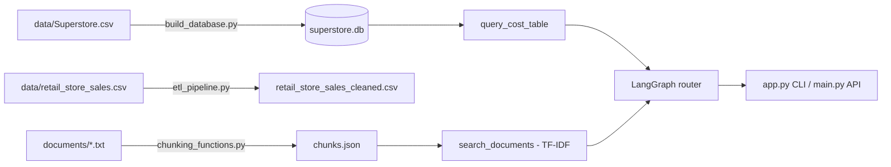
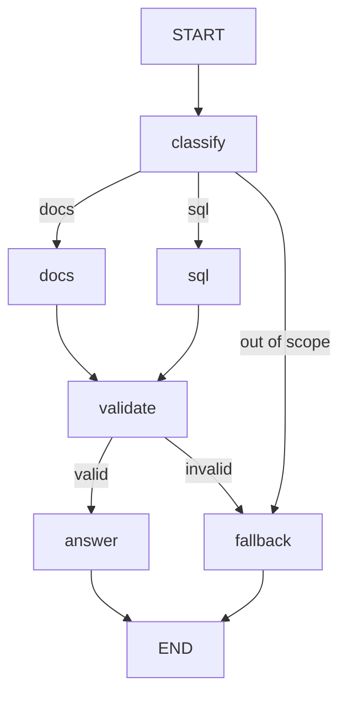

# Standalone Data + RAG Assistant

Internship project for Digital Future: a small local assistant that answers
**numeric questions with SQL** and **document questions with grounded sources**.
Built over a 12-week training plan ("Plan B").

Ask a question in plain English. A small LangGraph router decides whether it is a
data question (SQL over the Superstore sales database) or a document question
(TF-IDF retrieval over invoices, policies, FAQs and reports), validates the
result, and answers with the evidence it used. Questions outside the available
data get a safe fallback instead of a guess.

## Features

- **Data cleaning (ETL):** cleans the messy *Retail Store Sales* dataset
  (12,575 rows to 11,971) with logging and clear failure messages.
- **SQL analytics:** Superstore sales (9,994 orders, 2014 to 2017) in SQLite with
  summary views by category, sub-category and region. The model writes the SQL;
  a read-only guard runs it.
- **Document RAG:** TF-IDF retrieval over 4 sample documents, with metadata
  (document type) used as a hint, and sources shown with every answer.
- **LLM answers:** Gemini (free tier) answers only from the tool output, with
  automatic fallback across several Gemini models.
- **Router with validation and fallback:** LangGraph workflow
  `classify -> docs | sql -> validate -> answer | fallback`.

## Architecture

Data flow:



Router (`week11_graph.py`):



| Node | What it does |
|---|---|
| `classify` | Rule-based keywords (no LLM call) |
| `docs` | Calls `search_documents`; prefers the document type hinted by the question (policy, invoice, report) |
| `sql` | The model writes one `SELECT`; `query_cost_table` runs it read-only |
| `validate` | Docs: similarity at least 0.15. SQL: no error and at least one row |
| `answer` | The model answers only from the tool output and cites its source |
| `fallback` | "I don't have enough information to answer that." with the reason logged |

## Setup

Requires Python 3.11 or newer.

```bash
python -m venv .venv
.venv\Scripts\activate          # Windows (PowerShell: .venv\Scripts\Activate.ps1)
pip install -r requirements.txt
```

Get a free Gemini API key from Google AI Studio and put it in a `.env` file
(copy `.env.example`). Never commit `.env`.

```
GEMINI_API_KEY=your-key-here
```

## Usage

```bash
python app.py                     # interactive mode
python app.py "Who needs to approve a 15% discount?"
python app.py --demo              # run the 12 demo questions
```

Maintenance commands:

```bash
python app.py --clean             # run the ETL on the Retail Store Sales data
python app.py --rebuild           # rebuild superstore.db from data/Superstore.csv
python app.py --chunks            # rebuild chunks.json from documents/*.txt
```

REST API:

```bash
uvicorn main:app --reload
```

- `GET /health`
- `POST /ask` with `{"question": "..."}` returns the route, SQL or sources, and the answer
- `GET /costs` (Week 1 demo endpoint)
- Interactive docs at `http://127.0.0.1:8000/docs`

## Example output

Answers are generated by an LLM, so wording and the exact SQL vary between runs.

```
Q: Who needs to approve a 15% discount?
   route: docs
   retrieved: invoice_nov2024.txt, policy_discount_approval.txt
A: A 15% discount requires approval from the Regional Sales Manager.
   Source: policy_discount_approval.txt

Q: Which sub-category had a negative profit margin?
   route: sql
   SQL:   SELECT "Sub-Category", overall_profit_margin FROM subcategory_summary WHERE overall_profit_margin < 0
A: Based on the `subcategory_summary` table (covering data from 2014-01-03 to 2017-12-30),
   the sub-categories with a negative profit margin are:
   * Bookcases (-3.02%)  * Supplies (-2.55%)  * Tables (-8.56%)

Q: What is the capital of France?
   route: fallback
A: I don't have enough information to answer that.
```

`retrieved:` lists the chunks passed to the model; the answer cites the one it used.

## Demo questions

`python app.py --demo` runs: furniture discount policy, total invoice amount,
best region in October, late payment penalty, order processing time, accepted
payment methods, discount on the November invoice, sub-category with negative
margin, approval for a 15% discount, category with the highest profit margin,
an ambiguous question ("What about it?"), and an out-of-scope question.

## Project structure

```
app.py                  CLI entry point and maintenance commands
main.py                 FastAPI app (/health, /ask, /costs)
week11_graph.py         LangGraph router (classify, docs/sql, validate, answer, fallback)
week10_tools.py         Tools: search_documents, query_cost_table, summarize_result
week10_agent.py         Week 10 LangChain agent loop (kept for comparison)
llm_functions.py        Gemini helpers: structured JSON, retries, timeout, model fallback
build_database.py       Builds superstore.db from data/Superstore.csv and checks known values
etl_pipeline.py         Extract, transform, load for the Retail Store Sales data
cleaning_functions.py   Cleaning and validation functions
chunking_functions.py   Splits documents into chunks with metadata
db.py, file_utils.py    Week 1 utilities (SQLite helpers, CSV/JSON files)
week10_eval.py          Evaluation of the Week 10 agent (eval_results.csv)
week11_eval.py          Evaluation of the router (eval_results_week11.csv)
test_classify.py        Checks the classifier only (no API calls)
test_tools.py, test_tools2.py   Tool checks (no API calls)
data/                   Datasets (Superstore, Retail Store Sales, samples)
documents/              Source documents for the RAG (txt)
docs/                   Weekly reports and the training plan
*.ipynb                 Weekly notebooks (exploration and analysis)
chunks.json             Prepared document chunks
superstore.db           SQLite database (generated by build_database.py)
```

## Evaluation

The same 10 questions were run against two designs:

| | Week 10 (LangChain agent) | Week 11 (LangGraph router) |
|---|---|---|
| Correct answers (manual review) | 8/10 (2 partial) | 10/10 |
| LLM calls for the 10 questions | about 20 | 11 |

The comparison is not like-for-like (two automatic checks changed between
weeks, and the router rules were written after seeing Week 10 results). Details
and per-question notes are in the weekly reports in `docs/`.

## Limitations

- **TF-IDF retrieval** matches words, not meaning. It ranked the right policy
  document fourth for the "15% discount" question; the router recovers using the
  document-type hint, which only works because the corpus has 4 chunks.
- **The classifier is rule-based** and was written with the test questions in
  view, so 100% on them is optimistic. Unusual phrasing can be misrouted.
- **One route per question.** It cannot combine documents and data in one answer.
- **Model-written SQL varies** between runs and can be valid but semantically
  off. The read-only guard protects the data, not the query's correctness.
- **Validation is shallow:** it checks scores, errors and empty results, not
  whether a chunk actually contains the answer.
- **Different time periods:** the sales database covers 2014 to 2017; the sample
  documents refer to 2024. They are separate sources and not comparable.
- **Synthetic documents:** the 4 documents are fabricated samples.
- **Free-tier Gemini:** about 20 requests per day per model, and latency
  varies (from 2 seconds to over a minute when models are busy).
- **No authentication** on the API; intended for local use only.

## Future improvements

- Embeddings or hybrid search for retrieval.
- A check that retrieved text actually contains the answer.
- Test the router on unseen questions; move to an LLM classifier if needed.
- Load the cleaned Retail Store Sales data into SQLite so the assistant can
  answer questions about it too.
- Fix the SQL pattern for period questions (always group by year).

## Training plan progress

| Week | Topic | Status |
|---|---|---|
| 1 | Project setup, Git, FastAPI, SQLite | Done |
| 2 | Pandas and SQL basics (Superstore) | Done |
| 3 | Data cleaning and validation | Done |
| 4 | ETL pipeline | Done |
| 5 | GCP and BigQuery fundamentals | Not done: requires a Google Cloud billing account; local SQLite used instead |
| 6 | Analytics and data modeling | Done |
| 7 | RAG document preparation | Done |
| 8 | Basic RAG assistant | Done |
| 9 | LLM application basics (Gemini) | Done |
| 10 | LangChain tools | Done |
| 11 | LangGraph routing | Done |
| 12 | Capstone integration and documentation | This repository |
